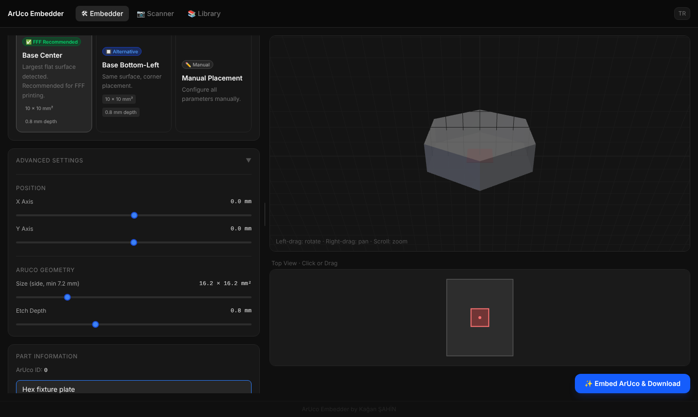

# STL ArUco Embedder

> A browser-based PWA that carves ArUco fiducial markers into STL files and scans them back with a webcam — fully offline, no server, no login.

**🔗 Live app: https://ekagansahin.github.io/STL-ArUco-Embedder/**

[](LICENSE)




---

## Overview

3D-printed parts are hard to identify once they leave the printer. Labels fall off, similar parts get mixed up, and recovering the material or print settings after the fact is tedious.

**STL ArUco Embedder** solves this by permanently carving an ArUco marker into the base of any STL before printing — the marker is boolean-subtracted directly from the geometry. After printing, a webcam scans the part and instantly retrieves its name, material, notes, and creation date from a local database.

Everything runs in the browser. No data ever leaves the device.

> **Desktop only.** Marker placement relies on mouse interaction and a WebGL 3D preview, so the app targets **Windows or macOS** computers. Opening it on a phone or tablet shows a notice asking the user to switch to a computer.

---

## Marker specification

The current build uses a **compact, high-distance 4×4 dictionary** chosen specifically for reliable reading off single-colour 3D prints.

| Property | Value |
|---|---|
| Dictionary | `ARUCO_4X4_50` (custom, 50 markers) |
| Marker IDs | **0 – 49** |
| Grid | 6 × 6 cells (4 × 4 data + 1-cell black border) |
| Default size | **10 × 10 mm²** (square, side adjustable 7.2 – 50 mm) |
| Default etch depth | **0.8 mm** (adjustable 0.2 – 2.0 mm) |
| Placement | Carved (subtracted) into the base face of the part |

### Why 4×4_50 instead of 4×4_1000?

A 1000-marker 4×4 dictionary packs so many codes into 16 data bits that the **minimum inter-marker Hamming distance is only 2** — a single misread bit (from low contrast, blur, or a mirrored surface) can flip one valid ID straight into *another* valid ID. That is the classic "it reads, but reads the wrong number" failure.

This build instead selects the **50 most mutually-distant codes** from that same code space, re-indexed to IDs 0–49. The result is a **minimum rotation-aware Hamming distance of 4**, so a single-bit error can no longer be confused with another marker. Combined with the scanner safeguards below, wrong reads are effectively eliminated.

> **Reprint note:** parts printed with the older 4×4_1000 markers will **not** be recognised by the current scanner. Re-embed and reprint them with the new dictionary.

---

## How it works

### 1. Embed

Upload any binary or ASCII STL. The app analyses the mesh face normals and proposes placement presets automatically:

- **Base Center** — centres the marker on the largest flat surface (recommended for FFF printing)
- **Alternative Center** — the next-largest flat surface
- **Base Bottom-Left** — corner placement on the same surface
- **Manual** — set orientation, position, size, and depth yourself

A live 3D viewer (drag to rotate, right-drag to pan, scroll to zoom) plus a 2D top-view footprint let you position the marker precisely, with a warning if it falls outside the mesh bounds. Marker size is shown as **A × A mm²** to make clear it is a square of side A. When you click **Embed ArUco & Download**, the app:

1. Rotates the mesh to the chosen orientation and finds the base (lowest) face
2. Generates the 6×6 pattern for the next available ID (0–49) from the `ARUCO_4X4_50` dictionary
3. Performs a boolean subtraction with [manifold-3d](https://github.com/elalish/manifold) (WASM) to carve the black cells into the surface
4. Exports a print-ready STL and saves both the original and print-ready files to IndexedDB

### 2. Scan

Open the Scanner tab and point your webcam at a printed part. The camera preview is mirrored for natural control (move your hand right, it moves right on screen) while detection runs on the true, un-mirrored frame.

Reading a **carved, single-colour** marker is much harder than reading a printed black-on-white one — the only contrast comes from shadows in the recesses. The scanner therefore uses two detection engines and several safeguards:

- **OpenCV.js `ArucoDetector` (primary engine).** Sweeps the adaptive-threshold window, refines corners to sub-pixel accuracy and handles inverted polarity (pockets that look *lighter* than a shiny surface). Each frame is tried as `{ raw · CLAHE } × { mirrored · normal }` and all candidates are merged. The ~13 MB OpenCV build is loaded lazily in the background; a status chip shows whether the advanced engine is active.
- **[js-aruco2](https://github.com/nicolasalber/js-aruco2) (fallback engine).** Used until OpenCV is ready, or if it fails to load. It runs a `scale × preprocessing × polarity × orientation` matrix — `{ 640 · 1024 px } × { raw · contrast stretch · CLAHE · black-hat } × { normal · negative } × { normal · mirrored }` — and the first hit wins. (js-aruco2 only tries the 4 rotations internally, never a mirror — so the flip is done here.)
- **Mirror handling.** A base-embedded marker is always seen mirrored by the camera, so both engines try the horizontally-flipped frame and map the corners back.
- **Registered-ID whitelist.** On camera start the set of marker IDs actually saved in the database is loaded; only those IDs are accepted. An unregistered read (e.g. a stray "136" that isn't in your library) is dropped and never counted.
- **Time-tiered temporal voting.** An ID is only locked once it *dominates recent frames*, not on a single lucky frame:
  - first **3 s** — strict: the same ID in **≥ 4 of the last 7** frames
  - after 3 s — relaxed: **≥ 2 of the last 4** frames
  - after **15 s** with no lock — the scanner stops and shows a "no marker found" message with a retry button
- **Live overlay feedback.** The detection box is **green** when an ID is confirmed, **yellow** for a valid candidate still being voted on, and **red** for a marker that was read but is not in the database.
- **ROI tracking and rate limiting.** Once a marker is found, the next frames scan only an expanded region around it first; detection runs at ~10 fps so the video stays smooth.
- **Camera controls and hints.** The scanner requests 1080p with continuous autofocus, shows torch and zoom controls when the camera supports them, and displays a focus-distance hint if the image looks blurry.

On a confirmed detection the app queries the local database and shows the part's details.

> **Tip:** keep a white quiet zone around the marker, and light it from the side/at an angle so the engraved cells cast shadows — grazing light dramatically improves contrast on single-colour prints.

### 3. Library

All parts are stored locally in IndexedDB via [Dexie.js](https://dexie.org/), so each computer keeps its own library. The Library tab lists every saved part with options to:

- Download the original or print-ready STL for any part
- Export the entire library as a ZIP (one folder per part plus a `database.json` metadata file)
- Import a previously exported ZIP — this is how a library is moved between computers
- Clear all data

---

## Tech stack

| Layer | Technology |
|---|---|
| UI framework | React 19 + TypeScript |
| Styling | Tailwind CSS v4 |
| Bundler | Vite 8 (Rolldown) |
| 3D rendering | Three.js r185 + OrbitControls |
| Boolean subtraction | manifold-3d (WASM) |
| ArUco detection | OpenCV.js 5 `ArucoDetector` (primary) + js-aruco2 (fallback), both loaded via script tag |
| Local database | Dexie.js v4 (IndexedDB) |
| ZIP export/import | JSZip |
| PWA | vite-plugin-pwa + Workbox |

The interface is available in English (default) and Turkish, toggled from the top bar; the choice is remembered.

---

## Project structure

```
public/
  aruco/
    cv.js              # js-aruco2 computer-vision helpers
    aruco.js           # js-aruco2 detector + dictionary base
    aruco_4x4_50.js    # the 50-marker ARUCO_4X4_50 dictionary (fallback scanner)
  opencv/
    opencv.js          # OpenCV.js 5 build with ArUco (primary scanner, lazy-loaded)
  icons/               # PWA icons
src/
  assets/
    aruco_dict_4x4_50.json   # 50 × 6×6 bit patterns (embedder + OpenCV dictionary)
  lib/
    aruco.ts           # builds the 3D marker pocket geometry from the bit patterns
    aruco-opencv.ts    # OpenCV.js loader, custom dictionary, primary detector
    aruco-scanner.ts   # detection pipeline: OpenCV first, js-aruco2 fallback matrix
    mesh.ts            # STL analysis, placement presets, embed pipeline
    manifold.ts        # manifold-3d WASM loader
    export.ts          # STL export
    db.ts              # Dexie / IndexedDB schema and helpers
    project-io.ts      # library ZIP export / import
  components/          # Viewer3D, Footprint2D, PlacementControls, PresetCards, UploadZone, MobileGate
  pages/               # EmbedderPage, ScannerPage, LibraryPage
docs/
  screenshot.png
```

All three consumers — the embedder, the OpenCV dictionary and the js-aruco2 dictionary (`aruco_4x4_50.js`) — use the same 50 codes, so the printed pattern and the decoders always agree.

---

## Getting started

### Prerequisites

- Node.js 20.19+ (22 or 24 recommended — CI builds on Node 24)
- npm 10+

### Install & run

```bash
git clone https://github.com/ekagansahin/STL-ArUco-Embedder.git
cd STL-ArUco-Embedder
npm install
npm run dev
```

Open the URL printed by Vite (served under the `/STL-ArUco-Embedder/` base path). Use a Windows or macOS computer with a webcam to test scanning.

### Build

```bash
npm run build
```

Output goes to `dist/`. The project is configured with `base: '/STL-ArUco-Embedder/'` for GitHub Pages, and a GitHub Actions workflow builds and deploys `dist/` automatically on every push to `main`.

---

## Limitations & roadmap

- **Single-colour, carved markers are inherently low-contrast.** The scanner compensates a lot in software, but a filament colour-change at the engrave layer (e.g. `M600`), a deeper etch, or a larger marker will always read more reliably.
- **50 IDs.** The dictionary intentionally trades capacity for robustness; if more than 50 distinct parts are ever needed, the dictionary can be regenerated at a larger size (at the cost of reprinting).
- **First scan downloads OpenCV.** The ~13 MB OpenCV.js build is fetched on first use of the scanner and cached for offline use afterwards; until then the lighter js-aruco2 engine is used.

---

## License

MIT — see [LICENSE](LICENSE).

---

## Author

**E. Kağan ŞAHİN**
